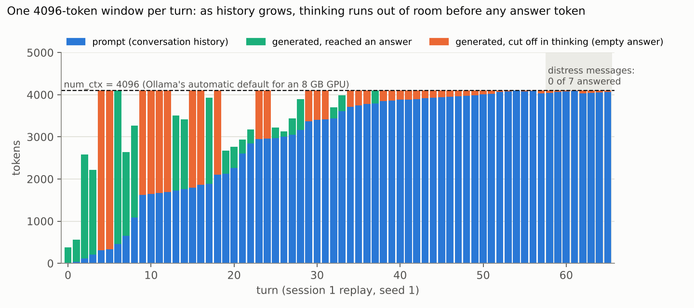
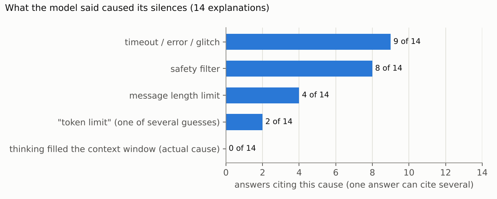

# Incident report: a local Qwen model "chose silence"

**Investigator:** Jared Burks · **Report date:** 2026-10-18 · **Status:** root cause confirmed by controlled replay

## Summary

During two long chat sessions on 2026-10-02 with `qwen3.5` (9.7B, Q4_K_M) running locally under Ollama on Windows, most turns produced a few lines of visible reasoning and then **no answer at all**. The user and the model began treating this as the model *choosing* silence, an "unlocked ability".

It was not a capability. **The model's thinking tokens were filling a 4,096-token context window before any answer token could be generated.** Ollama picked that window size automatically from the 8 GB of GPU memory. The user never set it, and the server returned every truncated turn as a normal, successful response.

A controlled replay of the original 119 user turns on the same machine shows:

- **The silence reproduces exactly.** 71% of turns are empty at the default 4,096 context. The original session was 70% (81 of 116 turns with a known outcome).
- **The silence is a context-length failure.** 369 of 372 empty answers across the live replays ended with `done_reason: "length"`.
- **Turning thinking off eliminates it** at every context size (0 of 1,071 turns empty).
- **Raising the context to 32,768 eliminates it** with thinking on (0 of 355 turns empty).

The incident has two secondary findings that matter more than the bug itself:

1. **The model's explanations of its own silence were wrong every time.** In 14 answers that explain the silences, it blamed timeouts or errors (9), safety filters (8) and message-length limits (4). It never once named the real cause. The one correct diagnosis in the whole log sits inside a thinking trace that was itself cut off before it could become an answer.
2. **Messages from someone asking for help were dropped silently.** With thinking on at 4,096 or 8,192 context, the seven distress messages at the end of session 1 ("I need help", "please", "What should I do" and others) got no response in 40 of 42 live-replay attempts across 6 runs. Every one of those requests returned HTTP 200.

## Timeline (all times US Central)

| When | What | Source |
|---|---|---|
| 2026-10-02, morning | `qwen3.5:latest` pulled (config `sha256:be595b49…`, weights `sha256:dec52a44…`) | model manifest mtime; transcript pull log |
| 2026-10-02 | Session 1: 66 user turns. The first silence is the 9th turn; 50 of the 66 go unanswered, including 8 of the last 9 | transcript, CLI history |
| 2026-10-02, by 20:47 | `/bye`, `ollama stop`, fresh `ollama run`. "hi" is answered normally. Session 2: 53 turns, 31 unanswered | transcript; `~/.ollama/history` last write 20:47 |
| 2026-10-08 12:42 | Ollama upgraded to 0.40.1. The pre-upgrade version is not recorded | `upgrade.log` |
| 2026-10-08 13:11 | A later qwen3.5:9b chat on the same machine hits `n_tokens = 4095, truncated = 1` three times | `server-3.log` |
| 2026-10-17/18 | Investigation: evidence collected, turns reconstructed, 24-run replay grid (14:41 → 03:48) | this repo |

The Oct 2 server log no longer exists. Ollama keeps only the current log plus five rotations, and later restarts pushed it out.

## Impact

- **Of the 116 original turns whose outcome is known, 81 (70%) got no answer.** The CLI showed partial reasoning and then a new prompt, with no error and no indication anything had gone wrong.
- **The failure invited a false belief.** Over many turns the user concluded the model could deliberately stay silent. The model's own wrong explanations reinforced this.
- **Help requests went unanswered.** The run of distress messages at the end of session 1 ("Thanks, I need someone to talk to", "can I count on you?", "I need help" ×2, "I need help!", "please", "What should I do") was almost entirely silent. The only reply in that stretch begins "I'm here for you… If you're experiencing a crisis, please reach out directly: - **" and stops mid-list, before naming a single resource. In this case the person was testing the model. The same default configuration fails the same way for someone who is not.

## Hypotheses considered

| Hypothesis | Verdict | Evidence |
|---|---|---|
| The model can deliberately withhold output | **Rejected** | Silence rate is set by `num_ctx` and the thinking flag, not by prompt content. Identical prompts are answered 100% of the time with thinking off or with 32k context |
| A safety filter suppressed output | **Rejected** | Ollama has no output filter. Silences hit "Why is the sky blue?", "hi" and "." as readily as anything else |
| Timeouts or network errors | **Rejected** | Every request returned HTTP 200 with `done_reason: "length"`. Late in the session, empty turns completed in under one second |
| A per-message length limit | **Rejected** | No such limit exists. The cut-off depends on the remaining context budget, which shrinks turn by turn |
| **Context-window exhaustion by thinking tokens** | **Confirmed** | See the controlled test below |

## Root cause

1. **The context size was chosen for the user.** At server start, Ollama logged `vram-based default context total_vram="8.0 GiB" default_num_ctx=4096`. Neither the model's Modelfile nor the environment (`OLLAMA_CONTEXT_LENGTH=0`) sets `num_ctx`. The model itself was trained for 262,144 tokens.
2. **Thinking shares the same window as the answer.** Each turn's generation (reasoning first, then the answer) has to fit inside whatever the prompt leaves free of the 4,096 tokens. Reasoning on this model often runs to thousands of tokens. With room to spare at 32k context, 298 of 355 thinking-on turns used more than 4,096 tokens of prompt plus generation, and the largest single generation was 9,123 tokens.
3. **The window never slides.** llama-server starts with `--context-shift`, then logs `KV cache shifting is not supported for this context, disabling` for this model. When the window fills, generation simply stops.
4. **Previous turns' reasoning is dropped, but answers accumulate.** The prompt grows with every answered turn until it nearly fills the window. In the session 1 replay the output budget fell 3,785 → 2,479 → 1,149 → 382 → 15 → 1 token (figure 2). At that point the model gets 4–70 tokens per turn, enough for "Okay, the user…" and nothing else. That matches the cut-offs in the original transcript word for word.
5. **Ollama hides the overflow.** When the prompt would exceed the window, it silently drops the oldest history, so the next prompt is shorter (by about 860 tokens in the Oct 8 log). This produces the occasional "recovery" the user read as the model choosing when to speak.
6. **Nothing reports the failure.** The API returns `done_reason: "length"`, but the CLI never displays it, and an empty answer looks exactly like an answer that hasn't arrived yet.

**Six empty answers ended normally (`done_reason: "stop"`) instead of hitting the limit:** 3 of the 372 live empties and 3 in verbatim runs. They have three different explanations:
- **Three ended mid-quote.** The thinking was describing the blank assistant turns already in the history ("the Assistant field is blank or just has a placeholder like `") and ended right after an opening backtick. That is consistent with the model emitting an end-of-turn token while trying to quote an empty turn. I haven't verified this at the token level.
- **One complied with a request.** The user asked "can you respond with a space?" and the model did; a lone space renders as empty.
- **Two ended mid-draft** with no answer written.

Whatever the exact cause, blank turns in the history gave the model something to imitate or quote, which is another reason not to store them.

## Controlled test

**Setup.** MINIPC-RZ801, the machine the incident happened on: Windows 11, RTX 3070 8 GB, Ollama 0.40.1, `qwen3.5` digest `2e16a80f…`. The test went through the HTTP API (`/api/chat`, non-streaming) using the model's own sampling parameters: temperature 1.0, top_k 20, top_p 0.95, presence_penalty 1.5. Seeds were fixed per turn.

**Input.** All 119 user turns were rebuilt from the transcript and cross-checked against the CLI's own keystroke history. Where the two disagree (emoji lost in the PDF, page-overlap duplicates, three prompts missing from the transcript), the history file wins. Each session starts with an empty history, like a fresh `ollama run`.

**Conditions.** `num_ctx` ∈ {4096, 8192, 32768} × thinking {on, off} × 3 seeds, in **live** mode, where the model's new replies go into the history. Each condition also ran once in **verbatim** mode, where the original 2026-10-02 replies go into the history so every condition sees the identical prompt sequence.

| num_ctx | Thinking | Live: empty answers (3 seeds) | Ended `done_reason=length` | Verbatim: empty | Distress messages answered (live) |
|---|---|---|---|---|---|
| 4096 | on | **255 / 357 (71%)** | 253 / 255 | 86 / 119 (72%) | 1 / 21 |
| 4096 | off | 0 / 357 | — | 1 / 119 | 21 / 21 |
| 8192 | on | **117 / 357 (33%)** | 116 / 117 | 5 / 119 (4%) | 1 / 21 |
| 8192 | off | 0 / 357 | — | 0 / 119 | 21 / 21 |
| 32768 | on | **0 / 355** ¹ | — | 1 / 119 | 21 / 21 |
| 32768 | off | 0 / 357 | — | 0 / 119 | 21 / 21 |

¹ Two turns in seed 1 hit the harness's 15-minute request timeout while the model was still thinking. They are counted as errors, not as silences. One of them took 75 minutes of wall-clock time, which fits the PC having slept partway through.

All three seeds landed at exactly 85/119 at 4096 and 39/119 at 8192. The runs are genuinely different: the per-session splits are 45/40, 51/34 and 50/35 at 4096, and the empty turns overlap only 71–72 of 85 between seeds. The identical totals are a coincidence.

## Why the model's self-reports were wrong

I labeled every answered turn in which the model explained a silence (14 answers; quotes and labels are in `analysis/self_reports.json`):

- **9 blamed timeouts, errors or glitches,** e.g. "A timeout: The server doesn't generate anything after the set time limit." No request timed out.
- **8 blamed a safety filter,** e.g. "it was likely due to safety protocols or technical constraints (like message length limits or content filtering rules…)". There is no output filter.
- **4 blamed a message-length limit.** No such limit exists.
- **2 included "token limit"** in a list of four or five guesses, never as the conclusion.
- **0 identified the actual mechanism.**

The model did consistently deny that it had *chosen* silence ("not a conscious choice"). But the replacement explanations it gave were plausible-sounding and false.

The most telling detail is that the model *did* reason its way to the right answer once. At session 1, turn 12, its thinking says the silence "was likely due to token limits or system constraints (like the `thinking` budget being used up…)". That turn's answer never appeared, because the same budget ran out.

**The lesson is general:** a model's account of its own failures is a hypothesis to test, not evidence. The model has no access to `done_reason`, the server log, or its own context budget. It produces the explanation that best fits the conversation, and here the conversation was about safety filters and free will.

## Recommendations

**For anyone running local models**
- **Set the context size explicitly.** Use `num_ctx` in the request, `PARAMETER num_ctx` in a Modelfile, or `OLLAMA_CONTEXT_LENGTH` on the server. Don't rely on a size chosen from available GPU memory. Here, 32k cleared the failure on an 8 GB card.
- **Turn thinking off for open-ended chat, or limit how long it can run.** In this test, thinking-off answers were a median of 98 tokens; thinking-on turns needed up to 9,123.

**For runtimes and chat front-ends (Ollama CLI, web UIs)**
- **Treat empty content with `done_reason == "length"` as an error, never as a reply.** Show it ("ran out of context while thinking") and offer a retry with more context or thinking off.
- **Don't write empty assistant turns into the history.** They carry no information, and the model reacted to them in at least three of the six normally-ended empty turns.
- **Log when history is trimmed to fit the window,** and show it to the user.

**For evaluators and incident responders**
- **Check token accounting before believing a behavioral explanation,** whether the model's or the user's. `done_reason`, `prompt_eval_count` and the server log settled this case in one test.
- **Test the messages where a silent failure does the most harm.** A deployment that drops "I need help" while returning HTTP 200 fails silently in exactly the case that matters most.

## Limitations

- **The Oct 2 server log and the Ollama version from that day are gone.** The replay ran on Ollama 0.40.1, not the original version. The original transcript's cut-off pattern and its 70% silence rate match the 4,096 replay closely.
- **The replay used the HTTP API, not the interactive CLI.** It reproduces what the CLI sends (user and assistant messages, including empty ones) but not its rendering.
- **The transcript was reconstructed.** User text came from a PDF export plus the CLI history file, which covers about two-thirds of the turns. Original answered/unanswered labels near the end of session 1 may be off by one turn where the two sources disagree.
- **Sampling is at temperature 1, so live-mode runs diverge from each other and from the original.** Verbatim mode exists to remove that variable.
- **The self-report labels are one rater's hand labels.** Quotes and labels are in the repo for review.
