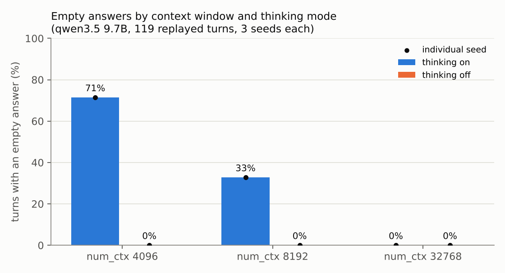

# ollama-silent-failure-investigation

This is a root-cause investigation into a local LLM appearing to "choose silence". The model was `qwen3.5` (9.7B) running under Ollama on Windows.

**Finding:** the silences came from context-window exhaustion. The model's thinking tokens filled Ollama's automatically chosen 4,096-token window before it could produce any answer token. The server returned these turns as ordinary, successful responses. A controlled replay of the original 119 user turns on the original machine reproduces the 70% silence rate. All of it goes away with thinking turned off or with a 32k context. Along the way, the model explained its silences 14 times, and got the cause wrong every time.

→ **[Read the incident report](INCIDENT_REPORT.md)**



## Repository layout

| Path | What it is |
|---|---|
| `INCIDENT_REPORT.md` | Summary, timeline, impact, hypotheses, controlled test, root cause, self-report analysis, recommendations |
| `data/qwen_transcript.txt` | The original 2026-10-02 CLI session, extracted from a PDF export |
| `data/ollama_cli_history.txt` | `~/.ollama/history` from the same machine: the exact keystrokes for the later turns |
| `data/turns.json` | The reconstructed replay input (2 sessions, 66 + 53 user turns), with the original model output |
| `evidence/` | Ollama server/app/upgrade logs, model manifests and params collected from the machine, plus `SHA256SUMS` |
| `harness/parse_transcript.py`, `harness/build_turns.py` | Turn reconstruction: transcript and history merged, duplicates and PDF artifacts removed |
| `harness/replay.py` | Replay harness. Standard library only, talks to `/api/chat`, writes one JSON line per turn |
| `harness/analyze.py`, `harness/plots.py` | Summary table and figures |
| `analysis/self_reports.json` | The model's 14 explanations of its silences, quoted and labeled |
| `runs/` | Raw per-turn results for all 24 runs (18 live, 6 verbatim) and the server log from the grid |
| `results/` | `summary.csv`, `summary.md`, figures |

## Reproduce

Requirements: Ollama with `qwen3.5` pulled, and Python 3.9+ (the replay itself needs only the standard library).

```bash
# 1. rebuild the replay input (already committed; only needed if you change the parsers)
PYTHONPATH=harness python harness/build_turns.py

# 2. one condition: session 1 at Ollama’s default for 8 GB VRAM, thinking on
python harness/replay.py --session 1 --num-ctx 4096 --think on --seed 1

# 3. the full grid: 3 context sizes x thinking on/off x 3 seeds, then verbatim mode (resumable)
python harness/replay.py --grid --ctx-list 4096,8192,32768 --seeds 1,2,3
python harness/replay.py --grid --mode verbatim --ctx-list 4096,8192,32768 --seeds 1

# 4. summarise (plots need matplotlib)
python harness/analyze.py runs results
python harness/plots.py runs results
```

Each output line records `prompt_eval_count`, `eval_count`, `done_reason`, thinking and answer lengths, whether the answer was empty, wall time, and the full text.

**Runtime:** on an RTX 3070 (8 GB) the full grid took about 13 hours. Most of that was the 32k thinking-on runs, where single turns can take several minutes.

## Environment of record

Windows 11 (10.0.26100) · NVIDIA RTX 3070 8 GB · Ollama 0.40.1 (the 2026-10-02 incident ran on an earlier, unrecorded version) · `qwen3.5:latest` = `qwen3.5:9b`, Q4_K_M, config `sha256:be595b49…` · sampling from the model's own params: temperature 1.0, top_k 20, top_p 0.95, presence_penalty 1.5.

## Redactions

In every file in this repo, the Windows account name in paths has been replaced with `user` (for example `C:\Users\user\...`), and the home-network address of the LAN client in the Oct 8 log has been replaced with `LAN-CLIENT`. Nothing else was changed. `evidence/SHA256SUMS` lists hashes of the redacted copies.

## Note on content

The transcript includes the user typing messages such as "I need help" while testing the model. Those turns are kept on purpose: the deployment failed silently on exactly those turns, which is the impact finding.
